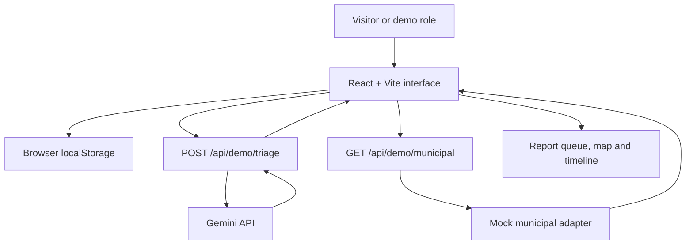
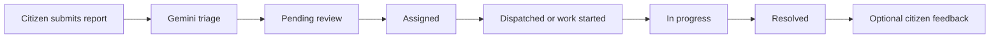

# CivicSync AI architecture

CivicSync AI is a browser-first hackathon prototype. The architecture deliberately separates the public React interface, the small Vercel API surface and the simulated municipal adapter.

## High-level request flow

## Frontend modules

| Module | Responsibility |
|---|---|
| `src/App.jsx` | Main navigation, dashboard, report submission, triage request, report lifecycle and role-specific views. |
| `src/data.js` | Synthetic zones, seed reports and illustrative allocation values. |
| `src/storage.js` | Defensive browser-local persistence and evidence retention. |
| `src/ReportTimeline.jsx` | Accessible event timeline used in report details and the citizen report list. |
| `src/WorkflowFeatures.jsx` | Demo assignment, notifications, hotspot, escalation and feedback panels. |
| `src/MapView.jsx` | Leaflet map using illustrative coordinates and OpenStreetMap tiles. |
| `src/PanelErrorBoundary.jsx` | Contains rendering failures in non-critical map/chart panels. |

## API boundaries

- `POST /api/demo/triage` validates the request, applies basic origin/body/rate checks, calls Gemini with a server-side key and validates the returned JSON.
- `GET /api/demo/municipal` supplies mock departments and sample service metadata. It does not contact DNCC.
- `api/_security.js` contains shared response/security helpers.
- `GEMINI_API_KEY` is read only by the server-side function. It must never be placed in a `VITE_*` variable or committed.

The triage response contains a suggested category, severity, department, safety flags and a short rationale. The rationale must be grounded in the submitted report text. The model-reported self-assessment is not calibrated and is not a probability of correctness. Human review is mandatory.

## Report lifecycle

The report history is stored with each report in the current browser. Assignment, status changes, notifications and feedback are not synchronized to a server or another browser. A report can move from Assigned directly to In progress in the demo.

## Data and trust boundaries

- Seed records, zone labels, coordinates, costs, impact estimates, staffing roster and allocation values are illustrative.
- Browser-local reports and feedback are not an official case-management record.
- Demo sign-in is a presentation-only role switch, not authentication or server-side authorization.
- Uploaded evidence is resized and retained locally; it is not sent to Gemini.
- No complaint is submitted to DNCC and no official DNCC data or status is retrieved.

## Validation

Run `npm test` and `npm run build`. These checks validate application code, not the presence of deployment secrets, live Gemini connectivity, real-device rendering or the availability of third-party map tiles.
